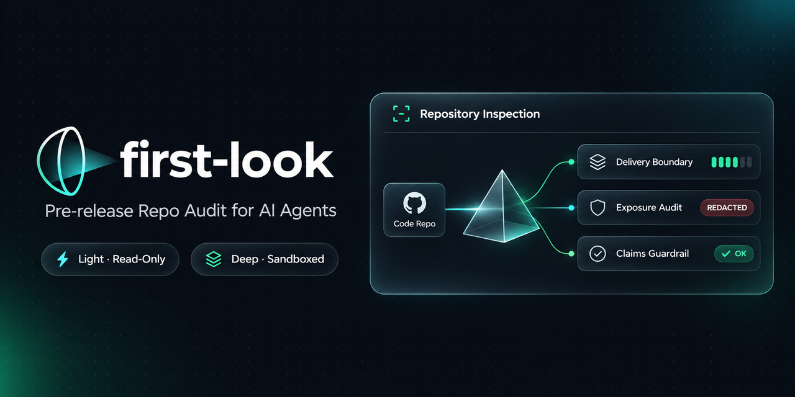

<p align="center">
  
</p>

<h1 align="center">first-look</h1>

<p align="center">
  <strong>A pre-release repository audit &amp; cold-start check skill for AI coding agents.</strong><br />
  站在第一次打开仓库的陌生访客视角，帮你查清<strong>外人看它是什么、真正带了什么与缺了什么、哪些不该露的内容已经暴露</strong>。
</p>

<p align="center">
  <a href="LICENSE"></a>
  <a href="https://agentskills.io/"></a>
  <a href="CHANGELOG.md"></a>
</p>

When you know a repository inside out, it is surprisingly easy to ship hidden assumptions ("one command runs everything" when a weight file or separate Python environment is missing) or unintended traces (personal commit emails, internal project codenames, draft roadmaps, or leftover agent files).

**`first-look`** gives any Agent Skills–compatible coding agent a disciplined, read-only **external-visitor lens** before you publish a repo or when you inspect an unfamiliar one.

---

## Two Modes

| Mode | Trigger | What it does |
| --- | --- | --- |
| **Light (default)** | Any normal first-look / pre-release check | **Read-only.** Never installs packages or downloads large files. Outputs 4 compact blocks: **1-sentence verdict**, **5-layer delivery boundary table**, **risk-ranked external exposure table**, and **public claims guardrail**. |
| **Deep (explicit)** | Only when you explicitly ask to install & run | Runs the actual release artifact inside a **disposable sandbox** (empty `HOME`, stripped credentials, verified archive paths) and binds every `Executed` verdict to the exact channel and digest. Refuses to execute on the host if isolation is unavailable. |

### What Light Mode Audits
- **True delivery boundaries (5 layers per stage)**: Code, Interpreter/Runtime, Weights/Data, Licenses/Platform permissions, and Network/Credentials — with explicit failure modes (`Hard stop` / `Fallback` / `Alternative` / `Unknown`) and evidence levels (`Doc claim` / `Static verified` / `Executed` / `Unverified`).
- **External exposure (3 visibility tiers)**: Separates `Local only`, `Planned public` (tracked tree, full reachable Git history, archives/packages), and `Already public` (remote/CI/releases/forks).
  - Source-level redaction: scanners never dump raw secrets, personal emails, or local usernames into tool logs.
  - Evidence-only AI/agent detection: reports concrete files/lines neutrally (never guesses authorship from prose style, and never flags intentionally published `AGENTS.md`/`CLAUDE.md` as defects by default).
  - Multi-license & third-party redistribution checks: separates **downloadable**, **usable**, and **redistributable**.

---

## Installation

Follows the standard [Agent Skills](https://agentskills.io/) layout (`SKILL.md` + `references/`). Compatible with Claude Code, Codex, Cursor, OpenCode, Oh My Pi, and other Agent Skills hosts.

### Option 1 — Skills CLI
```sh
npx skills add SeanYuanWSY/first-look
```

### Option 2 — Git clone (global or project-local)
```sh
# Universal shared skills directory (Codex, Oh My Pi, etc.)
git clone https://github.com/SeanYuanWSY/first-look.git ~/.agents/skills/first-look

# Or Claude Code personal skills directory
git clone https://github.com/SeanYuanWSY/first-look.git ~/.claude/skills/first-look
```

### Uninstall
```sh
rm -rf ~/.agents/skills/first-look   # or ~/.claude/skills/first-look
```

> **Platform note**: Shell snippets in [`references/checklist.md`](references/checklist.md) target POSIX shells (macOS / Linux); Windows users can use the noted PowerShell equivalents or tool-neutral steps.

---

## Usage Examples

- *"Run a `first-look` check on this repo before I make it public."*
- *"用 `first-look` 看看这个仓库发 GitHub 前有没有交付缺口或内部信息暴露。"*
- *"Run `first-look` in **deep mode** on `dist/mypkg-1.0.0.tar.gz` in a clean container."*

The agent replies in the language of your prompt using aligned CN/EN status labels.

---

## Scope & Non-Goals

- **Read-only by default**: inspects and recommends; never edits files, rewrites Git history, or publishes on its own.
- **Not a replacement** for unit tests, code review, penetration testing, or legal compliance sign-off.

---

## Repository Layout

- [`SKILL.md`](SKILL.md) — Core skill specification (modes, observer isolation, 4-block schema, deep-mode safety contract, CN/EN label map)
- [`references/checklist.md`](references/checklist.md) — Safe read-only commands, source-level redaction checks, non-Git/archive/OCI/LFS/multi-license rules, and sandbox isolation rules
- [`references/examples.md`](references/examples.md) — Calibrated Light & Deep output examples plus common anti-patterns
- [`assets/`](assets/) — Repository hero banner ([`hero.png`](assets/hero.png), 1280×640, GitHub Social Preview ready) and square icon ([`logo.png`](assets/logo.png), 512×512)
- [`CHANGELOG.md`](CHANGELOG.md) — Release history
- [`LICENSE`](LICENSE) — MIT License
