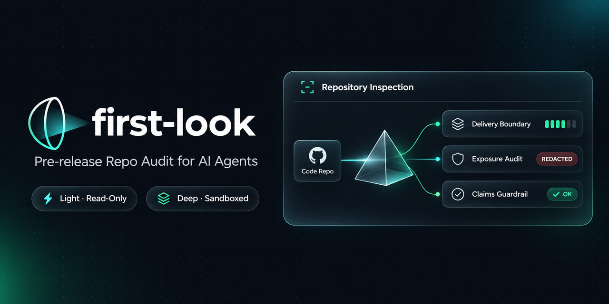

<p align="center">
  
</p>

<h1 align="center">first-look</h1>

<p align="center">
  <strong>面向 AI 编程 Agent 的仓库发布前体检与冷启动验收技能。</strong><br />
  站在第一次打开仓库的陌生访客视角，帮你查清<strong>外人看它是什么、公开交付带了什么与缺了什么、哪些未计划公开的内容已经暴露</strong>。
</p>

<p align="center">
  <a href="LICENSE"></a>
  <a href="https://agentskills.io/"></a>
  <a href="CHANGELOG.md"></a>
</p>

<p align="center">
  <a href="README.md">English</a> | <strong>简体中文</strong>
</p>

对自己写熟了的仓库，发布前最容易漏掉两类问题：一是**隐形前置条件**（文档写着“一条命令跑通”，实际缺模型权重、外部工具或独立运行环境），二是**意外外露的内部痕迹**（个人提交邮箱、内部代号、草稿路线图或残留的 Agent 配置文件）。

**`first-look`** 为兼容 Agent Skills 规范的编程 Agent 提供一套克制、默认只读的**外部陌生访客视角**，适合在仓库公开前自查，或快速摸清一个陌生仓库的真实交付边界。

---

## 双视角 × 两档深度

开查前若你未说明对象类型，Agent 会先用一句话确认采用哪种视角：

| 视角 | 适用对象 | 核查侧重点 |
| --- | --- | --- |
| **科研 / 模型视角** | 模型、论文复现、科学计算库 | 按阶段拆 5 层交付边界（代码、环境、权重/数据、许可/硬件、网络/凭据），定位复现硬停断点。 |
| **公开工具 / Skill 视角** | CLI、开源库、Agent Skill、应用工具 | 3 块真实上手流程报告（一句话结论、按安装→体验→接工具→跑出产出的 4 步卡点走查、值得补的项与一句话隐私确认，不堆砌审计噪音）。 |

| 深度 | 触发时机 | 执行内容 |
| --- | --- | --- |
| **轻档（默认）** | 常规首次体验 / 发布前体检 | **纯只读。** 不装依赖、不下载大包。固定输出 4 块紧凑报告：**一句判断**、**交付/上手体验表**、**按风险排序的外部暴露面表**、**对外口径红线**。 |
| **深档（显式触发）** | 仅当你明确要求安装并实跑验证时 | 在**一次性隔离沙箱**（空 `HOME`、剥离宿主凭据、校验归档路径安全）中对实际拟发布工件执行冷启动验证，并把每条`实跑核实`结论绑定到具体交付渠道与校验摘要。无法隔离时直接停步，绝不在宿主机硬跑。 |

### 轻档查什么
- **交付边界或首次上手体验**：按所选视角核对 5 层交付或 4 环节首次上手体验（[`references/checklist.md`](references/checklist.md) §4A / §4B），明确标注缺失后果与证据等级。
- **外部暴露面（三层可见性分开标）**：严格区分`仅本地`、`拟随发布可见`（已跟踪文件、全部可达 Git 历史、发布归档与软件包）和`线上已可见`（远端仓库、CI、Release、派生仓库）。
  - **源头脱敏**：扫描命令在进入终端或工具日志前即完成脱敏，绝不回显原始密钥、个人邮箱或本机用户名。
  - **仅凭证据识别 AI/Agent 痕迹**：只如实报告可定位的文件与行号，不靠文风猜测作者身份，也不把主动公开的 `AGENTS.md` / `CLAUDE.md` 默认判为缺陷。
  - **多许可证与第三方资产核查**：分开判定随包内容的**可下载**、**可使用**与**可再分发**边界。

---

## 安装

遵循标准 [Agent Skills](https://agentskills.io/) 目录结构（`SKILL.md` + `references/`），兼容 Claude Code、Codex、Cursor、OpenCode、Oh My Pi 及其他支持 Agent Skills 规范的客户端。

### 方式一：通过 Skills CLI 安装
```sh
npx skills add SeanYuanWSY/first-look
```

### 方式二：通过 Git 克隆安装（全局或项目级）
```sh
# 通用共享技能目录（适用于 Codex、Oh My Pi 等）
git clone https://github.com/SeanYuanWSY/first-look.git ~/.agents/skills/first-look

# 或 Claude Code 个人技能目录
git clone https://github.com/SeanYuanWSY/first-look.git ~/.claude/skills/first-look
```

### 卸载
```sh
rm -rf ~/.agents/skills/first-look   # 或 ~/.claude/skills/first-look
```

> **平台说明**：[`references/checklist.md`](references/checklist.md) 中的命令示例默认面向 POSIX Shell（macOS / Linux）；Windows 用户可使用文中注明的 PowerShell 等价命令或工具无关排查步骤。

---

## 使用示例

- *“按**科研视角**用 `first-look` 查一下这个模型仓，看缺少什么权重、数据集或环境门槛。”*
- *“按**公开工具视角**用 `first-look` 体检一下我们的 CLI / Skill，看陌生人 10 秒能不能看懂、有没有内部信息暴露。”*
- *“用 `first-look` 的**深档模式**，在干净容器里冷启动验证 `dist/mypkg-1.0.0.tar.gz`。”*

Agent 会自动跟随你的提问语言回复，并使用对应的中文或英文状态标签。

---

## 定位与非目标

- **默认只查不改**：只做检查并给出处置建议，绝不自动修改文件、重写 Git 历史或擅自发布。
- **不替代专项评审**：不能替代单元测试、代码审查、安全渗透测试或法律合规签字。

---

## 仓库结构

- [`SKILL.md`](SKILL.md) — 核心技能规范（两档模式、观察者隔离、4 块输出结构、深档安全契约、中英标签对照）
- [`references/checklist.md`](references/checklist.md) — 只读安全命令、源头脱敏排查、非 Git / 归档 / OCI / LFS / 多许可证规则与沙箱隔离要求
- [`references/examples.md`](references/examples.md) — 已校准的轻档与深档输出范例及常见反例
- [`assets/`](assets/) — 仓库头图（[`hero.png`](assets/hero.png)，1280×640，可直接用作 GitHub Social Preview）与方形图标（[`logo.png`](assets/logo.png)，512×512）
- [`README.md`](README.md) / [`README.zh-CN.md`](README.zh-CN.md) — 英文与简体中文说明文档
- [`CHANGELOG.md`](CHANGELOG.md) — 版本更新记录
- [`LICENSE`](LICENSE) — MIT 开源许可证
